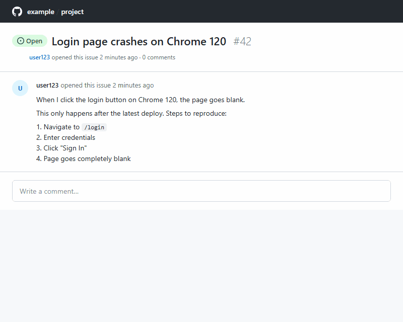

<div align="center">

# ⚡ Issue Triage Agent

**AI-powered GitHub Action for issue triage, duplicate detection, and context-aware replies**

[](https://github.com/zeldrisho/issue-triage-agent/actions)
[](LICENSE)
[](https://github.com/zeldrisho/issue-triage-agent/pulls)

Forked from [alexyan0431/issue-ai-agent](https://github.com/alexyan0431/issue-ai-agent).

</div>

## What It Does

When someone opens an issue in your repository, Issue Triage Agent:

1. **Classifies** the issue into a category (bug, feature, question, docs, duplicate, invalid, security)
2. **Labels** it with matching labels and a priority level (critical, high, medium, low)
3. **Detects duplicates** by searching existing issues and linking potential matches
4. **Replies** with a contextual comment — bugs get asked for reproduction steps, features get acknowledged, etc.
5. **Handles follow-up comments** — replies to user comments with relevant information

The current development version can also inspect repository files to inform replies and analyze supported GitHub-hosted images with a vision-capable model. See [Repository context](#repository-context) and [Attachments](#attachments) for limits and privacy considerations.

Choose an Anthropic or OpenAI-compatible provider; processing time depends on the provider and enabled features.

## Demo



1. **User opens an issue** — describes a login page crash
2. **Bot classifies** — labels it `bug` / `priority: high` in ~8 seconds
3. **Bot replies** — asks for reproduction details
4. **Duplicate check** — searches existing issues and links potential matches
5. **Follow-up comments** — replies to user comments with relevant info

## Quick Start

### Step 1: Add a workflow file

The Action SHA pins in these examples are illustrative and may not be the latest. Check the [releases page](https://github.com/zeldrisho/issue-triage-agent/releases) and replace them with the full commit SHA for your chosen release. Repository context and image analysis described below are unreleased and are not available in the pinned v0.2.0 example.

Create `.github/workflows/issue-triage.yml` in your repository:

```yaml
name: Issue Triage

on:
  issues:
    types: [opened]
  issue_comment:
    types: [created]

jobs:
  triage:
    runs-on: ubuntu-latest
    permissions:
      issues: write
      contents: read
    steps:
      - uses: zeldrisho/issue-triage-agent@3d3ef07a810fcb56c57137a9dafa9e17064d0986 # v0.2.0
        with:
          anthropic-api-key: ${{ secrets.ANTHROPIC_API_KEY }}
```

### Step 2: Add your API key

Go to **Settings > Secrets and variables > Actions > New repository secret**:

- Name: `ANTHROPIC_API_KEY`
- Value: your Anthropic API key (get one at [console.anthropic.com](https://console.anthropic.com))

### Step 3: Open an issue

That's it. The bot will automatically classify, label, and reply to new issues.

## LLM Providers

The bot supports any Anthropic or OpenAI API. Use the three inputs — `<provider>-api-key`, `llm-provider`, and `llm-base-url` — to match your setup.

### Anthropic

```yaml
- uses: zeldrisho/issue-triage-agent@3d3ef07a810fcb56c57137a9dafa9e17064d0986 # v0.2.0
  with:
    anthropic-api-key: ${{ secrets.ANTHROPIC_API_KEY }}
    llm-provider: anthropic
```

### OpenAI

```yaml
- uses: zeldrisho/issue-triage-agent@3d3ef07a810fcb56c57137a9dafa9e17064d0986 # v0.2.0
  with:
    openai-api-key: ${{ secrets.OPENAI_API_KEY }}
    llm-provider: openai
```

### Custom API endpoint

If your provider exposes an Anthropic or OpenAI compatible API, point `llm-base-url` to its address. Anthropic-compatible endpoints must support the SDK's current API version and bearer-token authentication (rather than relying only on `X-Api-Key`):

```yaml
# Anthropic-compatible endpoint
- uses: zeldrisho/issue-triage-agent@3d3ef07a810fcb56c57137a9dafa9e17064d0986 # v0.2.0
  with:
    anthropic-api-key: ${{ secrets.LLM_API_KEY }}
    llm-provider: anthropic
    llm-base-url: https://your-provider.example.com/api/anthropic
```

```yaml
# OpenAI-compatible endpoint
- uses: zeldrisho/issue-triage-agent@3d3ef07a810fcb56c57137a9dafa9e17064d0986 # v0.2.0
  with:
    openai-api-key: ${{ secrets.LLM_API_KEY }}
    llm-provider: openai
    llm-base-url: https://your-provider.example.com/v1
```

For compatible gateways, select the API protocol supported by the endpoint and set `llm.model` to a model ID available through that gateway. Selecting `openai` specifies the protocol, not necessarily the model provider.

Provider selection uses the Action input first, then `llm.provider` in repository configuration, then available credentials (OpenAI before Anthropic), defaulting to Anthropic. The custom base URL applies to the selected provider. If no key is available for that provider, issue triage uses mock responses and comment replies are skipped.

To select a model in GitHub settings, first update your workflow to a v0.3.0 or later release SHA; the v0.2.0 example above does not support `llm-model`. Then go to **Settings > Secrets and variables > Actions > Variables**, create a repository variable named `LLM_MODEL`, and pass it to the Action:

```yaml
with:
  llm-model: ${{ vars.LLM_MODEL }}
```

An unset variable leaves the repository configuration or provider default in effect. The input takes precedence over `llm.model`. Ensure the model is available through the selected provider or gateway.

Alternatively, create `.github/issue-triage-agent.yml` in your repo to specify a custom model:

```yaml
llm:
  model: your-model-name
```

## Configuration

Create `.github/issue-triage-agent.yml` in your repository to customize behavior. The bot works out of the box with sensible defaults — no config file required. If migrating from the upstream `.github/issue-ai.yml` config, rename it or set the `config-path` input to the old path.

```yaml
# .github/issue-triage-agent.yml
enabled: true

features:
  classify: true # Auto-classify issues
  reply: true # Post AI-drafted replies
  duplicateSearch: true # Detect duplicate issues
  commentReply: true # Reply to follow-up comments
  media: true # Analyze supported GitHub-hosted images

label_mapping:
  bug: ["bug"]
  feature: ["enhancement"]
  question: ["question"]
  docs: ["documentation"]
  duplicate: ["duplicate"]
  invalid: ["invalid"]
  security: ["security"]

security:
  max_issue_length: 10000 # Max chars of issue body to process

exclude:
  labels: ["wontfix", "skip-ai"] # Skip issues with these labels
  users: ["dependabot[bot]"] # Skip issues from these users

llm:
  provider: anthropic # "anthropic" or "openai"
  model: claude-haiku-4-5-20251001 # Model to use
  max_tokens: 2048 # Max tokens per LLM response
```

### Config Reference

| Key                         | Default                  | Description                                                                                         |
| --------------------------- | ------------------------ | --------------------------------------------------------------------------------------------------- |
| `enabled`                   | `true`                   | Master on/off switch                                                                                |
| `features.classify`         | `true`                   | Enable issue classification + labeling                                                              |
| `features.reply`            | `true`                   | Enable AI-drafted reply comments                                                                    |
| `features.duplicateSearch`  | `true`                   | Search for duplicate issues and link them                                                           |
| `features.commentReply`     | `true`                   | Reply to follow-up comments on issues                                                               |
| `features.media`            | `true`                   | Download supported GitHub images and send them to the model                                         |
| `label_mapping`             | _(see defaults above)_   | Maps AI categories to your repo's label names                                                       |
| `security.max_issue_length` | `10000`                  | Truncate issue body beyond this length                                                              |
| `exclude.labels`            | `["wontfix", "skip-ai"]` | Skip issues carrying these labels                                                                   |
| `exclude.users`             | `["dependabot[bot]"]`    | Skip issues opened by these users                                                                   |
| `llm.provider`              | Auto-detected            | LLM provider: `"anthropic"` or `"openai"`                                                           |
| `llm.model`                 | Provider-specific        | Model identifier; defaults to `claude-haiku-4-5-20251001` for Anthropic or `gpt-4o-mini` for OpenAI |
| `llm.max_tokens`            | `2048`                   | Max tokens per LLM response (1–8192)                                                                |

### Repository context

In the current development version, repository tools are enabled by default for initial and follow-up replies. The model can list repository paths, search the GitHub code index, and read text files from the default branch at a fixed commit using the GitHub API. It may read project guidance such as `AGENTS.md` when relevant; files are not loaded automatically. Search results may be stale or incomplete and must be verified against file contents. Files selected by the model are sent to the configured LLM provider, including files in private repositories. The Action can read any regular text file within the limits below, but cannot execute commands or browse the web. A limited review cannot establish conclusions about the entire repository. The token needs `contents: read`.

Repository files may be changed by contributors or contain embedded third-party material. Review who can modify the default branch and its instructions before enabling repository access; issue and comment content remains untrusted.

Repository access is limited to 40 tool calls, 1,000,000 bytes per file, 12,000 characters per read, 240,000 total returned file bytes, and eight tool rounds per reply. Each Action invocation has a 180-second deadline. Provider requests also time out after 60 seconds and retry eligible failures once. Files with invalid UTF-8 or binary content are skipped. The GitHub tree API can return an incomplete recursive listing for large repositories; the model can list directories individually and read files by path using bounded subtree traversal. Model and gateway support for tool calling is required. The model may quote repository content in its reply, so do not enable this Action where issue or comment authors should not be able to request repository contents.

### Attachments

In the current development version, with `features.media` enabled, bounded issue descriptions and follow-up comments are scanned for URLs on approved GitHub attachment hosts, including HTML images. Follow-up replies prioritize images in the comment and then include images from the original issue. Images are sent to the configured LLM provider (or custom endpoint), so use a vision-capable model and consider the privacy implications. Image content is untrusted. Disable this feature to prevent attachment downloads and image transmission. Videos are not supported.

Up to four attachments are checked, each limited to 4 MiB and 15 seconds per download. Only PNG, JPEG, GIF and WebP images are supported. Unsupported, inaccessible, oversized, or failed attachments are reported as unavailable to the model. For identifiable image-validation errors, the Action can make up to four additional per-image requests to isolate rejected images; unrelated provider errors are not retried as media failures. Only HTTPS URLs on approved hosts and redirects to approved hosts are fetched. Private or expired links may be inaccessible because downloads do not use GitHub credentials.

## Action Inputs & Outputs

### Inputs

| Input               | Required | Default                          | Description                                                |
| ------------------- | -------- | -------------------------------- | ---------------------------------------------------------- |
| `github-token`      | No       | `${{ github.token }}`            | GitHub token for API access                                |
| `anthropic-api-key` | No       |                                  | Anthropic API key                                          |
| `openai-api-key`    | No       |                                  | OpenAI API key                                             |
| `llm-provider`      | No       | Auto-detected                    | LLM provider; overrides repository configuration           |
| `llm-model`         | No       | Provider-specific                | Model identifier; overrides repository configuration       |
| `llm-base-url`      | No       |                                  | Custom base URL for LLM API (applies to selected provider) |
| `bot-login`         | No       | `github-actions[bot]`            | Login used to identify existing Action replies             |
| `config-path`       | No       | `.github/issue-triage-agent.yml` | Path to config file in repo                                |

At least one API key is required. If neither is set, the bot runs in **dev mode** with mock responses.

### Outputs

| Output           | Description                            |
| ---------------- | -------------------------------------- |
| `category`       | Classified issue category              |
| `priority`       | Classified issue priority              |
| `labels-applied` | Comma-separated list of applied labels |
| `reply-posted`   | Whether a reply comment was posted     |

Outputs are set for `issues` events only; `issue_comment` events do not set outputs.

Replies include a hidden event marker to avoid posting again on ordinary workflow reruns. Set `bot-login` to the account that posts comments when using a custom token. The check is best-effort: concurrent runs can both post before either sees the other's reply. If the comment history cannot be checked or reaches 2,000 comments, the reply is skipped.

## Contributing

See the [development guide](docs/development.md), including the architecture overview.

## License

[MIT](LICENSE)
